# Persistence and Data Model Proposal

## 1. Executive recommendation

Use PostgreSQL as the single source of truth, accessed from the Next.js server through Drizzle ORM and explicit service-layer transactions. Keep detailed operational documents in Google Drive/Sheets and persist typed URLs beside the records they describe.

The initial schema should contain 32 tables. It should remain relational and intentionally simple: Project is the operational root; repeated/history-bearing objects become child tables; compact one-to-one Site completion data remains together; statuses remain constrained text enums rather than lookup tables.

Key decisions:

- Store `financial_year_id` and `job_code` separately with a composite unique constraint. A Job Code repeats across financial years.
- Reserve the next Job Code atomically when the first Draft is saved.
- Keep high-level Project Status manual and separate from lifecycle state (`Draft`, `Active`, `Archived`, `Closed`).
- Use fixed-precision `numeric` columns for money and quantities.
- Preserve submitted/issued/dispatched records; use cancellation or superseding versions instead of silent overwrite.
- Derive dashboard totals, health, readiness and progress rather than storing them.

## 2. Current domain map

| Current concept | Classification | Persistence treatment |
| --- | --- | --- |
| Project and financial year | Core entity | `projects`, `financial_years` |
| Client PO summary | Child record | `client_purchase_orders` |
| Costing workspace summary | One-to-one workflow record | `costing_records` |
| Costing source and categories | Child plus many-to-many values | `costing_sources`, `costing_source_categories` |
| Quotation version | Historical child | `quotation_versions` |
| Commercial note | Chronological child | `costing_notes` |
| Design task/version | Versioned history | `design_requests`, `design_versions` |
| Purchase request, supplier quote and supplier PO | Core workflow plus children | Separate tables |
| Urgent purchase | Lightweight exception | `urgent_purchases` |
| Vendor Work Order | Core project child | `vendor_work_orders` |
| Production fixture/batch | Core project child | `production_batches` |
| Production process and QC | Child and one-to-one child | Separate tables |
| Dispatch and dispatch item | Parent/child transaction | Separate tables |
| Site summary, QC, handover and measurement | One-to-one project state | `site_executions` |
| Site work package and update | Child records | Separate tables |
| Fixture installation | Production-to-site bridge | `fixture_installations` |
| Bill | Project child | `bills` |
| Project payment | One-to-one project state | `project_payments` |
| Inventory item | Shared operational entity | `inventory_items` |
| Material request and allocation | Core Store workflow plus child | Separate tables |
| Receipt and issue | Immutable stock movement | `stock_movements` |
| Status/health/readiness/summary values | Enum or derived view | Constrained columns or queries; no summary tables |
| Form visibility, selected rows, validation messages | Temporary UI state | Do not persist |
| Drive/Sheet content | External document | Persist URL and minimal metadata only |

## 3. Proposed entities and relationships

```mermaid
erDiagram
  FINANCIAL_YEARS ||--o{ PROJECTS : contains
  INTERNAL_USERS ||--o{ PROJECTS : owns
  PROJECTS ||--o| CLIENT_PURCHASE_ORDERS : receives
  PROJECTS ||--o| COSTING_RECORDS : has
  COSTING_RECORDS ||--o{ COSTING_SOURCES : uses
  COSTING_SOURCES ||--o{ COSTING_SOURCE_CATEGORIES : covers
  COSTING_RECORDS ||--o{ QUOTATION_VERSIONS : versions
  COSTING_RECORDS ||--o{ COSTING_NOTES : records
  PROJECTS ||--o{ DESIGN_REQUESTS : has
  DESIGN_REQUESTS ||--o{ DESIGN_VERSIONS : versions
  PROJECTS ||--o{ PURCHASE_REQUESTS : has
  PURCHASE_REQUESTS ||--o{ SUPPLIER_QUOTES : receives
  PURCHASE_REQUESTS ||--o| SUPPLIER_POS : produces
  PROJECTS ||--o{ URGENT_PURCHASES : records
  PROJECTS ||--o{ VENDOR_WORK_ORDERS : commissions
  PROJECTS ||--o{ PRODUCTION_BATCHES : produces
  PRODUCTION_BATCHES ||--o{ PRODUCTION_PROCESSES : uses
  PRODUCTION_BATCHES ||--o| PRODUCTION_QC : checks
  PROJECTS ||--o{ DISPATCHES : sends
  DISPATCHES ||--o{ DISPATCH_ITEMS : contains
  PRODUCTION_BATCHES ||--o{ DISPATCH_ITEMS : dispatched_as
  PROJECTS ||--o| SITE_EXECUTIONS : executes
  SITE_EXECUTIONS ||--o{ SITE_WORK_PACKAGES : contains
  SITE_EXECUTIONS ||--o{ SITE_PROGRESS_UPDATES : logs
  SITE_EXECUTIONS ||--o{ FIXTURE_INSTALLATIONS : receives
  PRODUCTION_BATCHES ||--o| FIXTURE_INSTALLATIONS : installed_as
  PROJECTS ||--o{ BILLS : bills
  PROJECTS ||--o| PROJECT_PAYMENTS : receives
  PROJECTS ||--o{ MATERIAL_REQUESTS : requests
  MATERIAL_REQUESTS ||--o{ MATERIAL_REQUEST_ALLOCATIONS : allocates
  INVENTORY_ITEMS ||--o{ MATERIAL_REQUEST_ALLOCATIONS : assigned_to
  INVENTORY_ITEMS ||--o{ STOCK_MOVEMENTS : moves
  MATERIAL_REQUESTS ||--o{ STOCK_MOVEMENTS : may_reference
  PROJECTS ||--o{ ACTIVITY_LOG : records
```

Every operational table should use a UUID primary key, `created_at timestamptz`, `updated_at timestamptz`, and nullable `created_by_user_id`/`updated_by_user_id` where meaningful. Store timestamps in UTC. Human-readable numbers remain separate business identifiers.

## 4. Suggested schema fields

### Project foundation

| Table | Purpose and important columns | Relationships and constraints | Do not store |
| --- | --- | --- | --- |
| `financial_years` | `id`, `label`, `starts_on`, `ends_on`, `next_job_number`, `is_current` | Unique `label`; update counter in a locked transaction | Derived display formatting beyond the stored label |
| `internal_users` | `id`, `display_name`, `active`, nullable future `auth_subject` | Referenced by ownership/audit columns; no RBAC tables yet | Passwords or role policy |
| `projects` | `id`, `financial_year_id`, `job_code`, `project_name`, `brand`, `project_type`, `lead_user_id`, `project_manager_user_id`, `site_address`, `city`, client POC name/email/phone, manual `project_status`, `lifecycle_state`, `notes`, activation/archive/closure timestamps | Unique (`financial_year_id`, `job_code`); one root for all project records | Module health, Billing Readiness, Ready to Close |
| `client_purchase_orders` | `id`, `project_id`, PO number/date/amount, document URL, notes, status, timestamps | Many per project; amount positive; cancelled records retained | Total Active PO Value, parsed PO contents |

Drafts use `projects.lifecycle_state = 'Draft'`. Activation validates all approved mandatory fields and changes it to `Active`. Drafts stay out of Active Projects. Project Status remains a manually selected high-level field and is not inferred from module statuses.

### Costing and Design

| Table | Important columns | Relationships and constraints | Derived/not stored |
| --- | --- | --- | --- |
| `costing_records` | `project_id`, status, owner user ID, method, final internal cost, `current_quotation_version_id` | One per project; current-version pointer is explicit because “current” is a business selection, not always latest by date | Dashboard summary formatting |
| `costing_sources` | `costing_record_id`, source type/name, status, external costing URL, amount, required/received dates, notes | Many per costing record; overlapping sources allowed | Cheapest/preferred source |
| `costing_source_categories` | `costing_source_id`, `work_category` | Composite PK; category remains constrained text | Recommended categories from project type |
| `quotation_versions` | `costing_record_id`, version number, amount, document URL, status, created/sent dates, notes | Unique (`costing_record_id`, `version_number`); submitted versions preserved | Current amount/version if pointer supplies it |
| `costing_notes` | `costing_record_id`, occurred date, note | Append-oriented child | — |
| `design_requests` | `project_id`, design type, task name, priority | Stable design stream across revisions | Current/latest version summary |
| `design_versions` | `design_request_id`, version number, previous version ID, assigned/assigner user IDs, assigned/due/completed/submitted dates, task status, client-response status, drawing URL, notes | Unique (`design_request_id`, `version_number`); submitted rows are historical | Overdue health, assigned age |

Use `design_requests` plus `design_versions` rather than treating every version as an unrelated task. It gives one stable identity for a design stream, enforces version uniqueness, and preserves V1 → V2 lineage without duplicating the design subject.

### Purchase and outsourced execution

| Table | Important columns | Relationships and constraints | Derived/not stored |
| --- | --- | --- | --- |
| `purchase_requests` | `project_id`, optional related request ID, title, requester/owner user IDs or source text, dates, purpose, required-at/location, priority, status, material-list URL, supporting URL, rate-comparison-required/link, notes, approval decision/by/at/notes | Project has many; self-reference supports additional requirements | Requirement/delivery health |
| `supplier_quotes` | `purchase_request_id`, supplier name, amount, quotation URL, status, notes, added date | Many per request; no recommendation/final-supplier field | Cheapest quote |
| `supplier_pos` | `purchase_request_id`, PO number, supplier name, dates/amount/link, payment type, advance/credit dependency fields, delivery/receipt fields and condition | V1 zero-or-one per request; issued record protected | Delivery health |
| `urgent_purchases` | `project_id`, description, amount, vendor name, purchaser, date, reason, screenshot URL, notes | Separate lightweight exception | Approval policy not yet approved |
| `vendor_work_orders` | `project_id`, work category, vendor name, scope summary, WO number/date, commercial basis, agreed/payable amounts, execution dates, status, work-order URL, measurement URL, notes | Unique WO number within project; separate from Purchase | Deadline health, margin, vendor payment status |

Keep Management Approval fields on `purchase_requests`; a generic approval engine is unnecessary at this stage. Store `vendor_name` and `supplier_name` directly in V1. Later migrations can create master records, backfill normalized names, add nullable IDs, and retain snapshot names on historical issued documents.

### Production, QC and Dispatch

| Table | Important columns | Relationships and constraints | Derived/not stored |
| --- | --- | --- | --- |
| `production_batches` | `project_id`, fixture name, required/completed/packed quantities, manager IDs, drawing URL/version, planning/actual/deadline dates, status, material-requirement URL/status, delay reason/notes, lightweight labour/taker fields, notes | One row per fixture type or quantity batch, never per physical unit | Pending quantity, completion %, packed pending, deadline health |
| `production_processes` | `production_batch_id`, process name, execution type, optional sequence/display order | Many processes; parallel execution allowed | Aggregate completion unless future process tracking is approved |
| `production_qc` | `production_batch_id`, status/date/person, checklist/photos URLs, checked/passed/rework quantities, rework notes/deadline | One per batch; quantity checks non-negative and bounded by required quantity | “Rework Required” warning |
| `dispatches` | `project_id`, dispatch date, destination, transporter/contact, document URL, notes, status, cancellation reason/date | Many per project; dispatched records cannot be hard-deleted | Project dispatch totals/status |
| `dispatch_items` | `dispatch_id`, `production_batch_id`, quantity | Unique (`dispatch_id`, `production_batch_id`); quantity > 0 | Fixture cumulative dispatched quantity |

Creating or changing a dispatched shipment must lock affected production batches and calculate cumulative quantity from non-cancelled `Dispatched` records. A database can enforce positive item quantities and valid foreign keys; “cumulative dispatched ≤ min(packed, QC-passed)” requires transactional service logic because it aggregates multiple rows. Draft dispatches may be edited/deleted. Dispatched rows are cancelled, retaining reason/date.

### Site execution and completion

| Table | Important columns | Relationships and constraints | Derived/not stored |
| --- | --- | --- | --- |
| `site_executions` | `project_id`, recce/planned/actual/target completion dates, status, latest remarks; Site QC fields; rectification fields; handover status/date/document/notes; measurement status/date/by/link/notes | One per project. Project name, brand, PM, address and client POC remain joined from Project | Deadline health, days delayed, rectification warning, Billing Readiness |
| `site_work_packages` | `site_execution_id`, category, responsible-party type/name, planned/due/actual dates, status, delay reason, notes | Many per Site execution; not a Vendor Work Order duplicate | Package deadline health |
| `site_progress_updates` | `site_execution_id`, update date, update, blocker/dependency, next action | Append-oriented chronological log | Latest update ordering |
| `fixture_installations` | `site_execution_id`, `production_batch_id`, received-at-site quantity, installed quantity | Unique batch per Site execution; persist both quantities | Dispatched quantity, pending installation, installation % |

Keeping Site QC, Handover and Measurement in `site_executions` is appropriate for V1 because each is a compact one-to-one completion state. Split them later only if multiple inspections, handovers or measurement revisions become approved requirements.

### Billing and Payment

| Table | Important columns | Relationships and constraints | Derived/not stored |
| --- | --- | --- | --- |
| `bills` | `project_id`, bill type, bill number, bill date, amount, status | Many per project; bill number unique within project; amount `numeric(18,2)` and non-negative | Total Billed, Bill Count, latest status |
| `project_payments` | `project_id`, amount received, received date | One per project; amount non-negative | Total Billed, pending amount, Payment Status, Ready to Close |

Use `project_payments`, not fields on Project. It keeps the current one-row V1 simple and provides a clean migration path: later create `payment_transactions`, migrate the current amount/date as an opening transaction, then derive the project total.

### Store and Inventory

| Table | Important columns | Relationships and constraints | Derived/not stored |
| --- | --- | --- | --- |
| `inventory_items` | internal item code, name, category, unit, current simple storage location, reorder level, notes, active | Shared master entity | Quantity on hand, available quantity, low-stock flag |
| `material_requests` | `project_id`, title, requester source/user, request/required dates, material-list URL, status, notes, optional linked Purchase Request ID | Many per project; external sheet holds detailed requirement | Request health, availability summary, shortage total |
| `material_request_allocations` | `material_request_id`, `inventory_item_id`, requested quantity, allocated quantity, issued quantity, optional stock-check available snapshot | Unique item per request for V1; quantities non-negative; issued ≤ allocated | Shortage, remaining allocation |
| `stock_movements` | `inventory_item_id`, optional project/request/purchase-request IDs, movement type (`Receipt`, `Issue`, `Adjustment`), signed quantity or direction plus positive quantity, occurred date, person/source, storage location, supplier PO reference, notes, reversal reference | Append-only ledger; issues negative, receipts positive; corrections use reversal/adjustment | Current on hand = sum movements |

Prefer a minimal stock ledger over a mutable `quantity_on_hand` column. It prevents balance drift, preserves receipt/issue history, and allows reconciliation. Seed every opening balance as an `Adjustment` movement. Current available stock is ledger balance minus unissued active allocations. Persist the stock-check availability snapshot only when the historical decision matters; do not use it as current availability.

## 5. Document-link strategy

Use direct, semantically named URL columns in V1: `drawing_url`, `material_list_url`, `quotation_url`, `work_order_url`, `measurement_url`, and similar. This is preferable to a polymorphic `document_links` table now because:

- each workflow has a small, known set of links;
- direct columns preserve foreign-key clarity and required-link validation;
- the UI already gives each link a specific meaning;
- a generic entity-type/entity-ID table weakens relational integrity.

Quotation versions and supplier quotations remain rows because the document has business status/history, not merely a URL. Introduce an attachments table only when multiple arbitrary attachments per record become an approved requirement.

## 6. Stored versus derived decisions

### Persist

- Manual workflow statuses and decisions
- Source quantities: required, completed, packed, QC passed/rework, dispatched items, received-at-site, installed, allocated, issued and monetary amounts
- Dates that record business events
- Version numbers and predecessor links
- Cancellation/reversal reasons and timestamps
- Explicit “current quotation version” pointer
- External document URLs
- Stock-check available quantity only as an optional historical snapshot

### Do not persist

- Production pending quantity, completion percentage and packed-pending quantity
- Days delayed, deadline health and “Needs Attention” items
- Fixture/project dispatched totals and overall Dispatch Status
- Installation pending quantity and percentage
- Rectification warning and handover completion summary
- Billing Readiness
- Total Billed, Bill Count and latest-bill summary
- Pending Payment Amount, Payment Status and Ready to Close
- Store shortage and remaining allocation
- Inventory quantity on hand and current available quantity when using the movement ledger
- Dashboard counts and totals

The displayed status of an individual workflow record is stored because it represents a manual business decision. Time-relative labels such as Overdue are always recalculated. Historical values that would otherwise be lost—submitted versions, issued documents, dispatched/cancelled shipments, receipt/issue movements and stock-check snapshots—are persisted as records, not recomputed from current mutable state.

## 7. Master data and ownership

| Candidate | Next-phase treatment |
| --- | --- |
| Internal users/employees | Required now as a lightweight `internal_users` table for ownership and audit references; authentication subject nullable |
| Inventory items | Required now as operational master data |
| Project types, statuses, work categories, units, locations | Constrained text enums/checks for V1; avoid lookup-table administration |
| Brands and clients | Free text on Project for V1; future master tables after naming/duplication rules are approved |
| Vendors and suppliers | Snapshot names on transactions for V1; future separate masters because execution vendors and material suppliers differ |
| Project sites/locations | Project address/city plus constrained operational location text; future master only if multi-site projects are approved |

Prefer nullable internal user IDs for known employees and retain display-name snapshots where issued documents require historical readability. Do not use arbitrary actor strings as the long-term key. Seed approved employees before migrating ownership. Authentication and role enforcement can later attach to `internal_users.auth_subject` without rewriting domain foreign keys.

## 8. Audit, immutability and deletion

Use ordinary audit columns plus an append-only `activity_log` table containing `id`, `project_id`, nullable entity type/ID, action, actor user ID, timestamp, and a concise JSON change summary. This is not event sourcing; domain tables remain authoritative. Start logging sensitive lifecycle actions when persistence begins, even if actors are initially nullable.

| Record state/entity | Rule |
| --- | --- |
| Unsubmitted draft Project, Purchase Request, Dispatch or Work Order | Hard-delete allowed when it has no acted-on children |
| Submitted Design version | Immutable; revision creates next version |
| Issued Supplier PO or Work Order | No silent destructive edits; use explicit amendment/version policy when approved, otherwise cancel with reason/time |
| Dispatched shipment | Preserve; cancel rather than delete or rewrite quantities |
| Bill | Preserve after Raised; corrections need a future approved adjustment rule |
| Stock receipt/issue | Append-only; reverse with linked movement |
| Site progress update | Append-oriented; corrections should be visibly edited/audited |
| Project | Archive/close; do not hard-delete after activation |

Add nullable `cancelled_at` and `cancellation_reason` only to entities that support cancellation. Do not place meaningless cancellation columns on every table.

## 9. Transaction and consistency boundaries

The following operations must eventually be atomic:

- Lock financial-year counter, reserve Job Code, and insert first Project Draft.
- Activate Project only after validating mandatory fields.
- Create the next Design version and link it to the immutable predecessor.
- Issue Supplier PO and transition its Purchase Request consistently.
- Issue Work Order and preserve its issued commercial/document values.
- Change Dispatch to Dispatched while locking batches and validating cumulative available packed/QC-passed quantities.
- Cancel Dispatch and remove its quantities from derived totals without deleting history.
- Allocate Store stock while checking concurrent remaining availability.
- Insert issue movement and increment allocation issued quantity.
- Insert receipt/reversal movement and update related request state when applicable.

Use database constraints for keys, non-negative values, valid enum values and simple row-level relationships. Use service transactions for aggregate/concurrency rules spanning rows.

## 10. Persistence technology recommendation

| Option | Assessment |
| --- | --- |
| PostgreSQL | Best fit: relational integrity, transactions, fixed-precision numerics, reporting, audit history and future multi-user concurrency |
| SQLite | Excellent local prototype database but weak fit for concurrent departmental use and eventual hosted operations |
| Supabase/Postgres | Viable hosted Postgres option, especially when auth/storage are later approved; adopting it now would couple infrastructure decisions that remain deferred |
| Firebase/Firestore | Poorer fit for cross-module relationships, aggregate constraints and transactional reporting |
| Google Sheets as database | Familiar but unsafe as the authoritative transactional source for concurrency, constraints and auditability |

Recommended direction: managed PostgreSQL, with the hosting provider selected separately. Use Drizzle ORM for typed schema/migrations and SQL-visible queries. It is lightweight for this Next.js repository and does not obscure PostgreSQL constraints. Keep all mutations in server-side domain services; do not call the database directly from client components.

## 11. Phased migration

| Phase | Entities and local state replaced | Main dependency/risk | Validation gate |
| --- | --- | --- | --- |
| 1. Foundation | `financial_years`, `internal_users`, `projects`, client POs, activity log | Job Code concurrency; Draft/activation lifecycle; ownership mapping | Concurrent code reservation test, composite uniqueness, activation validation, UTC/audit verification |
| 2. Pre-production | Costing tables, Design requests/versions, Purchase tables, Vendor Work Orders | Historical version preservation and issued-document mutation rules | Version concurrency tests, Purchase/WO issue transactions, link/status validation |
| 3. Production to Site | Production batches/process/QC, Dispatch parent/items, Site execution/packages/updates/installations | Cross-row quantity limits and Dispatch-to-Site derivation | Partial/cancelled Dispatch tests, over-dispatch concurrency test, installation derivation checks |
| 4. Commercial completion | Bills and project payments | Fixed-precision money, correction policy, readiness derivations | Total/readiness parity with prototype and no floating-point use |
| 5. Store | Inventory items, Material Requests/allocations, stock movements | Opening balances and concurrent allocation/issue correctness | Ledger reconciliation, atomic receipt/issue/reversal tests, shortage/availability parity |
| 6. Cutover hardening | Replace remaining mock reads, add authorization/RLS when approved, operational backups | Mixed mock/database state and incomplete ownership | No client-side authoritative writes, restore rehearsal, end-to-end lifecycle acceptance |

Migrate one module boundary at a time behind repository interfaces. During each phase, seed fictional development data and compare derived outputs with current utility tests before removing that module’s mock source.

## 12. Open decisions and risks

1. **Deployment and Postgres provider:** choose hosting, region, backup/restore objectives and environments before database provisioning.
2. **Identity timing:** decide whether lightweight internal users will be seeded before authentication and how existing names map to stable IDs.
3. **Issued-record correction policy:** approve amendment/cancellation rules for Supplier POs, Work Orders and Bills before making them persistent.
4. **Money and quantity precision:** confirm currency scope and required decimal precision per inventory unit; proposed defaults are `numeric(18,2)` for money and `numeric(18,3)` for quantities.
5. **Stock opening balance and adjustments:** approve who can create/reverse Adjustment movements and the initial physical-count cutover process.
6. Confirm whether Site QC, Handover or Measurement will need multiple historical records rather than one current record.
7. Define when a payment over the billed total is permitted and how later transaction history will handle it.
8. Decide whether brands/clients need normalization before initial Project migration.
9. Define the minimum audit detail and retention period required for sensitive actions.
